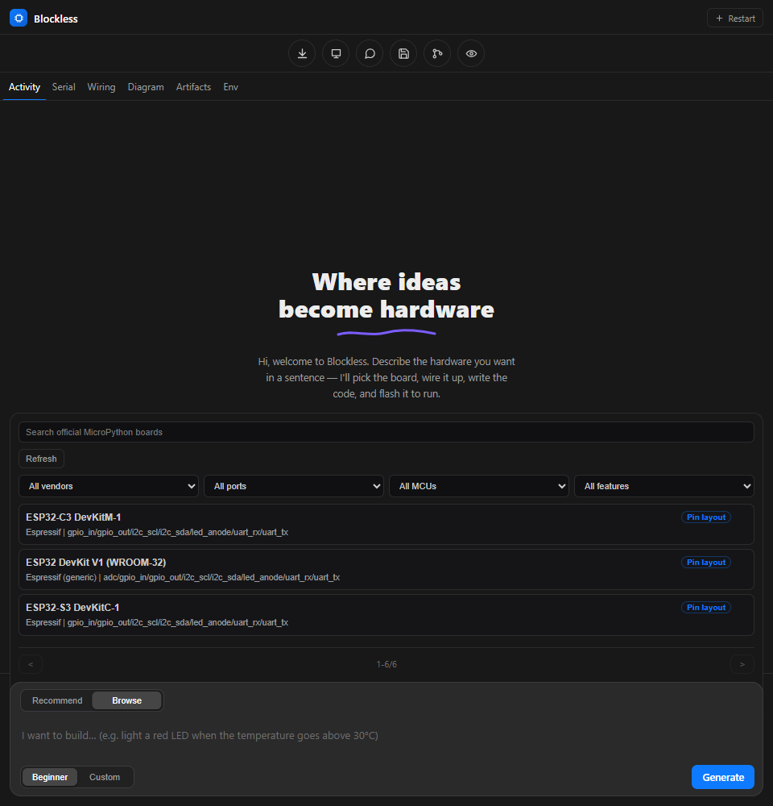
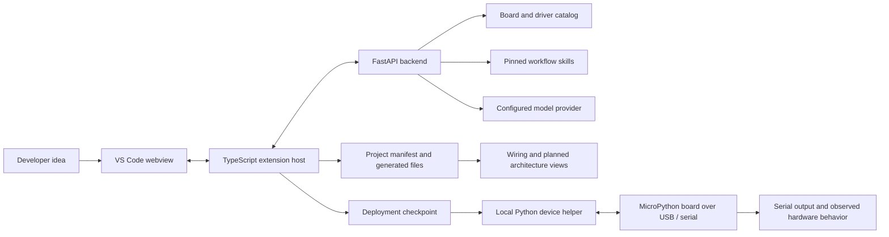

[English](README.md) | [简体中文](README.zh-CN.md)

<div align="center">

# MPY Hardware Extension

**An open-source VS Code extension for MicroPython hardware development.**

Board knowledge, peripheral drivers, wiring, and AI-assisted firmware development in the Blockless workbench.

[](LICENSE)
[](mpy-hardware-extension/package.json)
[](mpyhw-api/content/boards)
[](mpy-hardware-extension/src)

</div>



*The shipped VS Code webview rendered locally with the repository's six board profiles. This is a catalog/UI preview without a live backend or connected device; it does not represent a successful deployment.*

## Contents

[Overview](#overview) · [Features](#key-features) · [Architecture](#architecture) · [Hardware support](#supported-boards-and-peripherals) · [Installation](#installation) · [Quick start](#quick-start) · [Configuration](#extension-configuration) · [Development](#development) · [License](#license)

## Overview

MPY Hardware Extension is the VS Code part of **Blockless — MicroPython Hardware Builder**. Describe a hardware project, review its components and board, inspect the proposed wiring, generate firmware, and deploy through the local device helper when the setup is ready.

This monorepo contains the extension/webview in `mpy-hardware-extension/`, a FastAPI service in `mpyhw-api/`, reusable skill and driver submodules, and a separate installer workspace. Hardware facts and inspectable project artifacts guide the workflow alongside model-generated code.

## Key features

| Area | Implemented tools |
| --- | --- |
| Hardware-aware planning | Board selection, component review, capability matching, project manifests |
| Pins and interfaces | Curated pin capabilities, recommendations, reserved pins, and logic-voltage notes |
| Wiring and architecture | Wiring derived from device/manifest data; a planned architecture view, distinct from a reverse-engineered code graph |
| Drivers and packages | Curated driver contexts, source metadata, device package tools, and a missing-driver generation workflow |
| Code generation | Skill-driven project generation, artifact inspection, static code checks, and iterative workflow events |
| Environment diagnosis | Doctor checks for Python, dependencies, board connection, and MicroPython |
| Device workflow | Serial helper, deployment checkpoint, device files, package installation, and serial output |
| Project continuity | Session records, artifact browser, version saving, and read-only Git history |

Real-board acceptance remains a separate verification step. Mock/shim tests and a successful code build cannot prove that every supported board/peripheral combination works physically.

## Why hardware-aware development matters

A valid Python expression says little about a board's flash-reserved pins, input-only GPIOs, bus assignments, or 3.3 V logic limits. This project keeps board metadata and driver context alongside the generated manifest so developers can inspect the physical assumptions before connecting and running hardware.

The metadata is reusable: [`mpyhw-api/content/boards/`](mpyhw-api/content/boards) describes board capabilities; [`mpyhw-api/content/packages/`](mpyhw-api/content/packages) supplies driver context and provenance. The [manifest builder](mpy-hardware-extension/src/core/manifest-builder.ts) links pin roles, board recommendations, and package versions. Coverage depends on those records and still needs hardware verification.

For example, the ESP32 DevKit V1 profile recommends GPIO21 for I2C SDA and GPIO22 for I2C SCL, marks GPIO34 as input-only, and reserves GPIO6–GPIO11 for the flash bus. These are board-profile facts to review, not a universal wiring recipe.

## Architecture



| Directory | Responsibility |
| --- | --- |
| [`mpy-hardware-extension/src/extension/`](mpy-hardware-extension/src/extension) | VS Code host, identity, environment, device and session integration |
| [`mpy-hardware-extension/src/core/`](mpy-hardware-extension/src/core) | Workflow, manifests, code checks, wiring and protocol logic |
| [`mpy-hardware-extension/src/webview/`](mpy-hardware-extension/src/webview) | Workbench, board selector, artifacts, serial and environment UI |
| [`mpy-hardware-extension/python/shim/`](mpy-hardware-extension/python/shim) | Local board communication helper |
| [`mpyhw-api/`](mpyhw-api) | Authentication, catalog, credits, skill loading, generation and streaming |
| [`third_party/`](third_party) | Pinned MicroPython skills and GraftSense drivers |
| [`blockless-installer/`](blockless-installer) | Separate Rust installer workspace |

## Supported boards and peripherals

These six boards have checked-in pin-aware profiles:

| Board family | Profile |
| --- | --- |
| ESP32 DevKit V1 / WROOM-32 | [ESP32](mpyhw-api/content/boards/esp32-devkit-v1.json) |
| ESP32-S3 DevKitC-1 | [ESP32-S3](mpyhw-api/content/boards/esp32-s3-devkitc-1.json) |
| ESP32-C3 DevKitM-1 | [ESP32-C3](mpyhw-api/content/boards/esp32-c3-devkitm-1.json) |
| ESP8266 NodeMCU | [ESP8266](mpyhw-api/content/boards/esp8266-nodemcu.json) |
| Raspberry Pi Pico | [Pico](mpyhw-api/content/boards/raspberry-pi-pico.json) |
| Raspberry Pi Pico W | [Pico W](mpyhw-api/content/boards/rpi-pico-w.json) |

The board browser can expose additional official or vendor records. A firmware download entry alone does not imply a complete local pin layout or tested peripheral support.

The driver catalog includes sensors, displays, lighting, communication, and other peripheral categories. Check a package's interfaces, version, pin roles, and original license rather than assuming all catalog entries are compatible with every board. See the [real-board acceptance checklist](docs/real-board-acceptance.md).

## Installation

You need VS Code **1.90+**, Python **3.10+** on PATH, and a network connection for authentication, generation, and required firmware/driver downloads. Install the USB-serial driver appropriate for your board on Windows.

Install a provided `.vsix` with **Extensions → Install from VSIX…**. To build one from source, use Node.js **22+**:

```sh
git clone --recurse-submodules https://github.com/FreakStudioCN/mpy-hardware-extension.git
cd mpy-hardware-extension
git submodule update --init --recursive
cd mpy-hardware-extension
npm ci
npm run package
code --install-extension build/mpy-hardware-extension.vsix
```

The repeated directory name is intentional: the extension package lives inside the monorepo. Both submodules are required for skill loading and packaging. See [extension packaging](docs/vscode-extension-publish-flow.md) for the maintained distribution workflow.

## Quick start

1. Open the **Blockless** view in VS Code, or run **Blockless: Open Panel**.
2. Sign in with GitHub when prompted for the configured service.
3. Open **Env** and review Python, dependencies, device, and MicroPython checks.
4. Choose a board, or keep **Recommend**, then describe a small project.
5. Review the component and plan checkpoints. Check the proposed pins, power, and wiring against the actual hardware.
6. Inspect generated files, **Wiring**, and **Diagram**. The diagram describes the proposed project structure.
7. Connect the board, review the deployment checkpoint, and run the device flow. Inspect serial output and the real device to establish the result.

The extension prepares a local tool environment on first use. If environment setup or board detection fails, follow Doctor's diagnostic output before trying deployment again.

## Usage examples

Start with a small, observable requirement:

> Blink the onboard LED once per second on my Raspberry Pi Pico.

Then add hardware context:

> Read an AHT20 temperature sensor over I2C and show the reading in the serial monitor. Use my selected ESP32 board.

These are example prompts, not prevalidated reference circuits. Confirm that the matching driver context exists, review the generated bus/pin assignments, and verify the output on your own board. New board profiles and driver contexts should include provenance, interface constraints, and reproducible examples.

## Extension configuration

These settings are **machine-scoped**: set them in VS Code User/Remote settings.

| Setting | Default | Purpose |
| --- | --- | --- |
| `mpyhw.apiBaseUrl` | Empty | Use the configured hosted service, or override with a self-hosted backend URL |
| `mpyhw.pythonPath` | Empty | Developer override for the fallback runner's Python |
| `mpyhw.pipIndexUrl` | Empty | Developer override for fallback dependency installation |
| `mpyhw.autoOpenPanel` | `false` | Open the workbench when VS Code starts |

Example User settings for local backend development:

```json
{
  "mpyhw.apiBaseUrl": "http://127.0.0.1:8787",
  "mpyhw.autoOpenPanel": true
}
```

Prompts and generated code pass through the configured backend/model provider. Review the service configuration before using private designs; keep API keys and device/session data out of commits.

## Development

Backend development uses Python 3.10+, PostgreSQL, and the checked-in dependency files. The Windows convenience launcher also needs Docker Desktop and PowerShell.

From the repository root:

```powershell
python -m venv mpyhw-api/.venv
mpyhw-api/.venv/Scripts/python -m pip install -r mpyhw-api/requirements.txt
Copy-Item mpyhw-api/.env.example mpyhw-api/.env
# Configure local secrets in the ignored .env. For a deterministic backend stub:
$env:MPYHW_LLM_STUB = "1"
powershell -ExecutionPolicy Bypass -File mpyhw-api/scripts/dev-up.ps1
Invoke-RestMethod http://127.0.0.1:8787/v1/health
Invoke-RestMethod http://127.0.0.1:8787/v1/health/ready
```

Stub mode exercises the development flow and does not provide real model generation. Restart the daemon after backend changes; see [backend operations](mpyhw-api/deploy/README.md). For the extension:

```sh
cd mpy-hardware-extension
npm test
npm run typecheck
npm run package
```

Backend tests require a **separate test database**; see [development notes](docs/development.md). No full-stack or hardware test result is implied by this README.

## Documentation and contributing

- [Local development and focused validation](docs/development.md)
- [Real-board acceptance](docs/real-board-acceptance.md)
- [Extension packaging](docs/vscode-extension-publish-flow.md)
- [Board profiles](mpyhw-api/content/boards), [driver context](mpyhw-api/content/packages), and [workflow contracts](contracts)
- [Screenshot provenance](docs/assets/readme/README.md) and [third-party notices](THIRD_PARTY_NOTICES.md)

Contributions to board metadata, driver contexts, wiring validation, diagnostics, and reproducible device examples are welcome. Include the board/firmware version and redacted logs in bug reports. Distinguish generated proposals, mocked results, and real-board measurements.

## Related projects

| Project | Focus |
| --- | --- |
| [MicroPythonOS AI App Builder](https://github.com/FreakStudioCN/micropythonos-ai-app-builder) | Natural-language MicroPythonOS apps, browser preview, MPK packaging and deployment |
| [AI Agent Embedded Device Debugging Kit](https://github.com/FreakStudioCN/ai-agent-embedded-debugging-kit) | Agent observation, physical control and testing of real embedded hardware |

The projects are independently maintained. Shared interests and resources do not imply a complete integration between their software stacks.

## License

Project-owned code is licensed under [MIT](LICENSE); the packaged extension carries the same text in [LICENSE.txt](mpy-hardware-extension/LICENSE.txt). The existing `blockless` copyright attribution is retained. Third-party skills, drivers, dependencies, logos, and imported documentation remain subject to their original terms; see [THIRD_PARTY_NOTICES.md](THIRD_PARTY_NOTICES.md).
