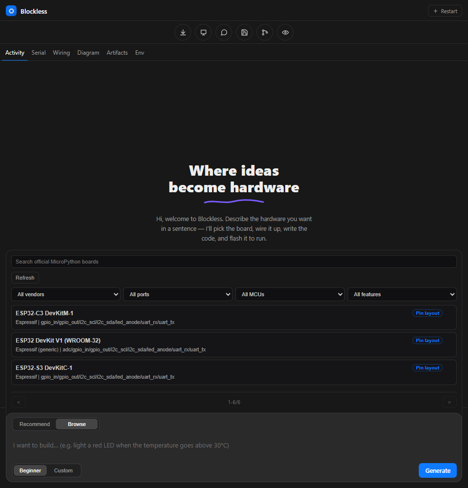
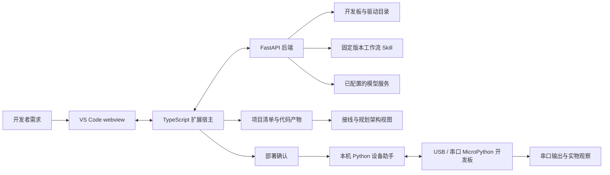

[English](README.md) | [简体中文](README.zh-CN.md)

<div align="center">

# MPY Hardware Extension

**面向 MicroPython 硬件开发的开源 VS Code 扩展。**

在 Blockless 工作台中连接开发板知识、外设驱动、硬件接线和 AI 辅助固件开发。

[](LICENSE)
[](mpy-hardware-extension/package.json)
[](mpyhw-api/content/boards)
[](mpy-hardware-extension/src)

</div>



*真实扩展 webview 的本地渲染，载入仓库内六种板卡配置。此图是无在线后端、无设备连接的目录/界面预览，不表示已成功部署。*

## 目录

[项目概述](#项目概述) · [主要功能](#主要功能) · [架构](#架构) · [硬件支持](#开发板与外设支持) · [安装](#安装) · [快速开始](#快速开始) · [配置](#扩展配置) · [开发](#开发) · [许可证](#许可证)

## 项目概述

MPY Hardware Extension 是 **Blockless — MicroPython Hardware Builder** 的 VS Code 扩展。开发者描述硬件项目，审阅器件与开发板，检查接线方案，生成固件，并在环境就绪后通过本机设备助手部署。

本仓库包含 `mpy-hardware-extension/` 扩展和 webview、`mpyhw-api/` FastAPI 服务、可复用 Skill 与驱动子模块，以及独立安装器工作区。开发流程同时参考模型生成结果、真实硬件资料和可检查的项目产物。

## 主要功能

| 方向 | 已有工具 |
| --- | --- |
| 硬件方案 | 开发板选择、器件审阅、能力匹配、项目清单 |
| GPIO 与接口 | 精选引脚能力、推荐分配、保留引脚和逻辑电压说明 |
| 接线与架构 | 从设备/清单数据推导接线；架构页展示规划结构，不冒称源码逆向分析图 |
| 驱动和包 | 驱动上下文、来源元数据、设备包工具、缺失驱动生成流程 |
| 代码生成 | Skill 驱动的项目生成、产物浏览、静态检查和迭代事件 |
| 环境诊断 | Doctor 检查 Python、依赖、开发板连接和 MicroPython |
| 设备操作 | 串口助手、部署确认、设备文件、包安装和串口输出 |
| 项目延续 | 会话记录、产物浏览、版本保存和只读 Git 历史 |

真实开发板验收仍是独立步骤。Mock/shim 测试或构建成功，不代表所有板卡与外设组合已经通过实机验证。

## 为什么需要理解硬件的开发工具

Python 语法正确并不能保证引脚不是 Flash 总线、GPIO 支持输出、总线分配合理或电平符合 3.3 V 要求。本项目将开发板元数据和驱动上下文关联到生成清单，让开发者在连接与运行前检查物理假设。

[`mpyhw-api/content/boards/`](mpyhw-api/content/boards) 维护开发板能力；[`mpyhw-api/content/packages/`](mpyhw-api/content/packages) 提供驱动上下文与来源。[清单构建器](mpy-hardware-extension/src/core/manifest-builder.ts) 将引脚角色、开发板推荐和包版本关联起来。这些资料可以复用，但覆盖范围仍取决于具体记录，并需要硬件验证。

例如 ESP32 DevKit V1 配置推荐 GPIO21 作为 I2C SDA、GPIO22 作为 SCL，标记 GPIO34 仅支持输入，并将 GPIO6–GPIO11 保留给 Flash 总线。这些是需要核对的板卡资料，不是适用于所有硬件的通用接线方案。

## 架构



| 目录 | 职责 |
| --- | --- |
| [`mpy-hardware-extension/src/extension/`](mpy-hardware-extension/src/extension) | VS Code 宿主、身份、环境、设备和会话管理 |
| [`mpy-hardware-extension/src/core/`](mpy-hardware-extension/src/core) | 工作流、清单、代码检查、接线与协议 |
| [`mpy-hardware-extension/src/webview/`](mpy-hardware-extension/src/webview) | 工作台、选板、产物、串口和环境界面 |
| [`mpy-hardware-extension/python/shim/`](mpy-hardware-extension/python/shim) | 本机开发板通信助手 |
| [`mpyhw-api/`](mpyhw-api) | 认证、目录、额度、Skill 加载、生成与流式事件 |
| [`third_party/`](third_party) | 固定版本的 MicroPython Skills 与 GraftSense 驱动 |
| [`blockless-installer/`](blockless-installer) | 独立 Rust 安装器工作区 |

## 开发板与外设支持

以下六种开发板拥有仓库内的引脚配置：

| 开发板 | 配置 |
| --- | --- |
| ESP32 DevKit V1 / WROOM-32 | [ESP32](mpyhw-api/content/boards/esp32-devkit-v1.json) |
| ESP32-S3 DevKitC-1 | [ESP32-S3](mpyhw-api/content/boards/esp32-s3-devkitc-1.json) |
| ESP32-C3 DevKitM-1 | [ESP32-C3](mpyhw-api/content/boards/esp32-c3-devkitm-1.json) |
| ESP8266 NodeMCU | [ESP8266](mpyhw-api/content/boards/esp8266-nodemcu.json) |
| Raspberry Pi Pico | [Pico](mpyhw-api/content/boards/raspberry-pi-pico.json) |
| Raspberry Pi Pico W | [Pico W](mpyhw-api/content/boards/rpi-pico-w.json) |

选板器还可以展示更多官方或厂商条目。有固件下载入口，不等于已有完整本地引脚布局或经过实测的外设支持。

驱动目录包含传感器、显示、灯光、通信等类别。使用前应核对包版本、接口、引脚角色及原始许可证，不假设所有目录条目适配每一种开发板。实机操作见[开发板验收清单](docs/real-board-acceptance.md)。

## 安装

需要 VS Code **1.90+**、PATH 中可用的 Python **3.10+**，以及认证、生成和必要固件/驱动下载所需网络。Windows 上安装开发板对应的 USB 转串口驱动。

已有 `.vsix` 时，使用 **扩展 → 从 VSIX 安装…**。从源码构建需 Node.js **22+**：

```sh
git clone --recurse-submodules https://github.com/FreakStudioCN/mpy-hardware-extension.git
cd mpy-hardware-extension
git submodule update --init --recursive
cd mpy-hardware-extension
npm ci
npm run package
code --install-extension build/mpy-hardware-extension.vsix
```

重复的目录名是正常结构：扩展包位于同名仓库的子目录。两个子模块均参与 Skill 加载与打包，不能省略。发行流程见[扩展打包说明](docs/vscode-extension-publish-flow.md)。

## 快速开始

1. 打开 VS Code 的 **Blockless** 视图，或运行 **Blockless: Open Panel**。
2. 按配置服务的提示使用 GitHub 登录。
3. 在 **Env** 中检查 Python、依赖、设备和 MicroPython 状态。
4. 选择开发板或保留 **Recommend**，描述一个小型项目。
5. 审阅器件与方案确认卡，结合实物核对引脚、电源和接线。
6. 查看生成文件、**Wiring** 和 **Diagram**；架构图表达计划结构。
7. 连接开发板，审阅部署确认后执行设备流程，通过串口和实物表现判断结果。

扩展首次使用会准备本机工具环境。环境安装或设备识别失败时，先按 Doctor 的诊断处理，再继续部署。

## 使用示例

先从易观察的需求开始：

> 让我的 Raspberry Pi Pico 板载 LED 每秒闪烁一次。

再添加外设信息：

> 使用已选 ESP32 开发板，通过 I2C 读取 AHT20 温度传感器，在串口输出读数。

这些是示例提示词，不是已经验收的参考电路。先确认存在匹配驱动上下文，审阅总线和引脚分配，再在实际开发板上验证。新增板卡或驱动资料应附来源、接口限制和可复现示例。

## 扩展配置

以下设置为 **machine scope**，应在 VS Code 用户/远程设置中配置：

| 设置 | 默认 | 用途 |
| --- | --- | --- |
| `mpyhw.apiBaseUrl` | 空 | 使用默认托管服务，或指定自托管后端 |
| `mpyhw.pythonPath` | 空 | 开发者覆盖备用运行器的 Python |
| `mpyhw.pipIndexUrl` | 空 | 开发者覆盖备用运行器依赖安装源 |
| `mpyhw.autoOpenPanel` | `false` | VS Code 启动时自动打开工作台 |

本地后端开发的用户设置示例：

```json
{
  "mpyhw.apiBaseUrl": "http://127.0.0.1:8787",
  "mpyhw.autoOpenPanel": true
}
```

提示词与生成代码会经过所配置的后端和模型服务。处理私有设计前核对服务配置，API key、设备信息和会话数据不要提交到仓库。

## 开发

后端开发需要 Python 3.10+、PostgreSQL 和仓库依赖文件。Windows 便捷启动器另需 Docker Desktop 和 PowerShell。

在仓库根目录执行：

```powershell
python -m venv mpyhw-api/.venv
mpyhw-api/.venv/Scripts/python -m pip install -r mpyhw-api/requirements.txt
Copy-Item mpyhw-api/.env.example mpyhw-api/.env
# 在被忽略的 .env 配置本机密钥；确定性后端桩模式如下：
$env:MPYHW_LLM_STUB = "1"
powershell -ExecutionPolicy Bypass -File mpyhw-api/scripts/dev-up.ps1
Invoke-RestMethod http://127.0.0.1:8787/v1/health
Invoke-RestMethod http://127.0.0.1:8787/v1/health/ready
```

桩模式用于检查开发流程，不提供真实模型生成。后端修改后需要重启守护进程，见[后端运维说明](mpyhw-api/deploy/README.md)。扩展检查：

```sh
cd mpy-hardware-extension
npm test
npm run typecheck
npm run package
```

后端测试必须使用**独立测试数据库**，见[开发说明](docs/development.md)。本文不表示已经运行完整系统或实机验收。

## 文档与参与贡献

- [本地开发与必要验证](docs/development.md)
- [真实开发板验收](docs/real-board-acceptance.md)
- [扩展打包](docs/vscode-extension-publish-flow.md)
- [板卡配置](mpyhw-api/content/boards)、[驱动上下文](mpyhw-api/content/packages)、[工作流协议](contracts)
- [截图来源](docs/assets/readme/README.md)与[第三方声明](THIRD_PARTY_NOTICES.md)

欢迎完善板卡资料、驱动上下文、接线验证、诊断和可复现硬件示例。问题报告应附板卡/固件版本和脱敏日志，区分生成方案、模拟结果和真实测量。

## 相关项目

| 项目 | 方向 |
| --- | --- |
| [MicroPythonOS AI App Builder](https://github.com/FreakStudioCN/micropythonos-ai-app-builder) | 自然语言生成 MicroPythonOS 应用、浏览器预览、MPK 打包与部署 |
| [AI Agent Embedded Device Debugging Kit](https://github.com/FreakStudioCN/ai-agent-embedded-debugging-kit) | Agent 观察、物理控制和测试真实嵌入式硬件 |

项目独立维护，共享目标或资料不代表已经完成软件栈集成。

## 许可证

项目自有代码采用 [MIT](LICENSE)，扩展包内的 [LICENSE.txt](mpy-hardware-extension/LICENSE.txt) 使用相同文本，保留已有 `blockless` 版权归属。第三方 Skill、驱动、依赖、标识和引入文档遵循各自原始条款，见 [THIRD_PARTY_NOTICES.md](THIRD_PARTY_NOTICES.md)。
